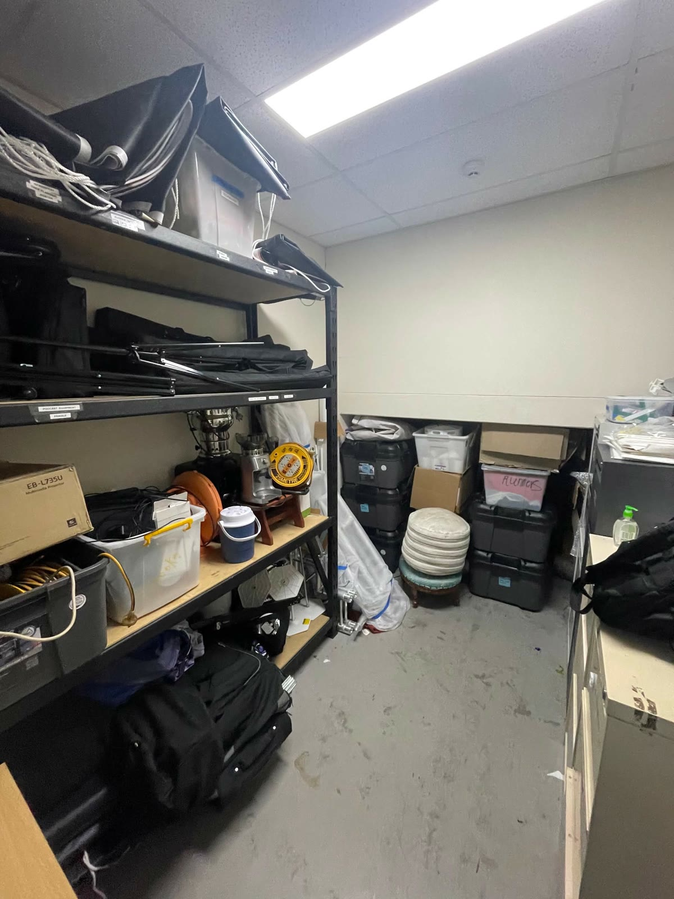

# Storeroom 3D

A to-scale 3D digital twin of a real storeroom, built from **one photo, two short walkthrough videos and a stocktake spreadsheet**. It shows where everything lives, who has borrowed what, and what's hiding in the back row of the box wall.

**Live:** the project page has a side-by-side of the real room and the model, and `/demo` is the full interactive app.

> This repository is the public portfolio version. All inventory, names and locations in it are **made up**, and the demo runs entirely in your browser (changes are saved in `localStorage`, and *Reset demo* restores the starting data).



## What it does

- **Find anything:** search highlights every matching spot in 3D; click one and the camera flies there (drawers slide open).
- **Know who has it:** take items or whole boxes out and return them; the home screen lists everything currently out.
- **See behind the boxes:** fade the front and middle rows of the 4 × 4 × 3 box wall to see the back row.
- **Reorganise:** move boxes to empty slots or swap two boxes; add, edit and delete items and storage spots.
- **History & stocktake:** every change is logged; the inventory table filters and exports to CSV.
- **Works on phones:** handy for looking something up while standing in the storeroom.

## How the model is built

There's no modelling software involved. The room is generated in code from a handful of measurements in [`lib/layout.ts`](lib/layout.ts):

- Room size (≈ 2.4 × 2.9 m) was estimated from objects of known size in the photo: a 1.8 m boltless shelving unit, 1.32 m four-drawer filing cabinets, 600 mm ceiling tiles and an 850 mm door.
- The spreadsheet's location codes map directly to geometry: boxes are `(column, level, row)` on the box wall, drawers are `cabinet.drawer` (e.g. `1.2`), and shelves are levels 1–4 from the top.
- Walls fade when they face the camera (a dollhouse cut-away), and labels are drawn onto canvas textures, so renaming a box updates it in 3D immediately.

## Tech

Next.js 16 (App Router) · React 19 · TypeScript · three.js with React Three Fiber and drei · Tailwind CSS 4 · Vercel.

The production version adds a Postgres (Neon) backend with server-side validation, per-person sign-in with owner/admin/member roles, optional two-step sign-in and rate-limited logins. In this demo, [`lib/demoStore.ts`](lib/demoStore.ts) runs the same operations in the browser instead.

## Run it locally

```bash
npm install
npm run dev
```

Then open http://localhost:3000 (project page) or http://localhost:3000/demo (the app).

## Credits

Built by Haris Syed ([@harissyed2006](https://github.com/harissyed2006)). Developed with AI-assisted tooling. All data in the demo are fictional though the image of the room is real.
